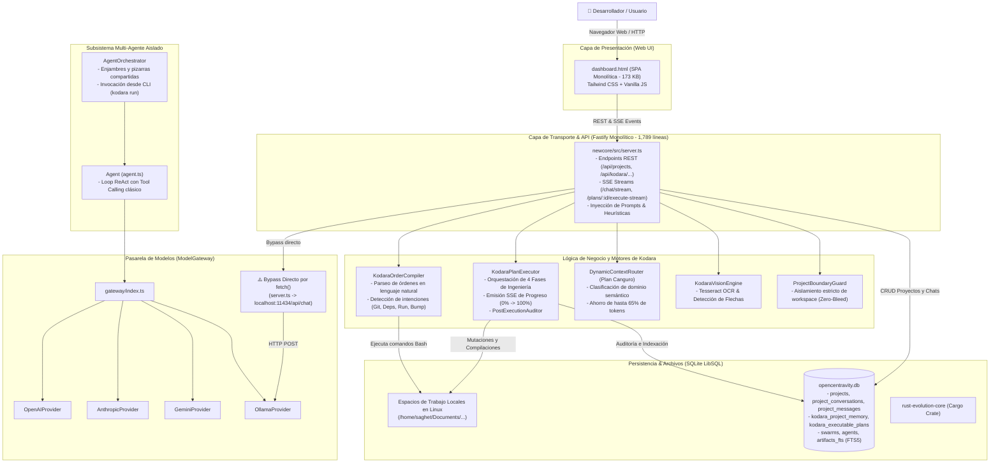

# Arquitectura Actual de Kodara (Current Architecture)
**Versión Auditada**: 1.0.0 (Rama `main`)  
**Ecosistema**: TypeScript ESM, LibSQL (SQLite), Fastify, Bun, Rust Core

---

## 1. Diagrama de la Arquitectura Actual

---

## 2. Flujo de Datos Principal (Ciclo de Vida de una Petición)

### 2.1 Flujo del Chat Interactivo (`/chat/stream`)
1. El usuario envía un mensaje desde `dashboard.html` junto a imágenes opcionales, `conversationId` y `projectId`.
2. `server.ts` intercepta la petición en `/chat/stream`:
   - Guarda el turno del usuario en `project_messages` (SQLite).
   - Verifica si es un comando especial (`/recordar`, `/learn`).
   - Analiza imágenes adjuntas mediante `KodaraVisionEngine` (OCR y anclaje al código).
   - Carga el historial completo persistente desde SQLite con `KodaraOrderCompiler.loadFullConversationHistory()`.
   - Consulta las órdenes compiladas y las lecciones aprendidas de `KodaraProjectMemory`.
   - Aplica el ruteo del *Plan Canguro* (`DynamicContextRouter`) para seleccionar qué módulos de conocimiento inyectar en el System Prompt.
3. **Bypass del Gateway**: En lugar de utilizar `ModelGateway.chatStream()`, `server.ts` ejecuta directamente `fetch('${config.ollamaBaseUrl}/api/chat')` contra la instancia local de Ollama (ej. DeepSeek-R1).
4. La respuesta es retransmitida token a token mediante SSE al navegador.

### 2.2 Flujo de Generación y Ejecución de Planes (`[▶ Proceed]`)
1. Cuando la respuesta del asistente contiene un plan estructurado, `PlanExecutor.createExecutablePlan()` lo registra en SQLite (`kodara_executable_plans`) en estado `READY_TO_PROCEED`.
2. El usuario pulsa el botón interactivo **`[▶ Proceed]`** en la cabina.
3. El frontend emite un stream SSE a `/api/kodara/plans/:id/execute-stream`.
4. `server.ts` invoca `KodaraPlanExecutor.executePlanById()`:
   - **Fase 1 (0% -> 25%)**: Carga historial, ejecuta clonado Git si aplica (`executeGitClone()`) e indexa los archivos del proyecto.
   - **Fase 2 (25% -> 55%)**: Aplica mutaciones de código fuente protegidas por `ProjectBoundaryGuard` y realiza auditoría SAST con Semgrep.
   - **Fase 3 (55% -> 85%)**: Resuelve e instala dependencias (`executeDependencyInstall()`) con Bun, Go, Cargo o Pip; compila binarios.
   - **Fase 4 (85% -> 100%)**: Lanza la aplicación (`executeApplicationLaunch()`), verifica su ejecución activa, audita el cumplimiento con `auditExecutionCompliance()` y registra la lección verificada en `KodaraProjectMemory`.

---

## 3. Modelo de Datos Actual (Esquema SQLite)

La base de datos relacional `opencentravity.db` gestiona el estado persistente a través de LibSQL:

- `projects`: Identificador (`proj_...`), nombre, ruta física en disco (`path`), fecha de creación.
- `project_conversations`: Sesiones de chat vinculadas a un proyecto (`id`, `project_id`, `title`, `updated_at`).
- `project_messages`: Mensajes individuales (`id`, `conversation_id`, `role`, `content`, `metadata_json`).
- `kodara_executable_plans`: Planes de trabajo (`plan_id`, `project_id`, `phases_json`, `status`, `execution_report_md`).
- `kodara_project_memory`: Aprendizaje local (`memory_id`, `project_id`, `language`, `error_signature`, `root_cause`, `verified_fix`, `confidence`).
- `kodara_core_memory`: Principios arquitectónicos inmutables y reglas globales.
- `swarms` & `agents`: Esquemas heredados para agentes autónomos y tareas de enjambre (usados principalmente por `cli.ts`).
- `artifacts` & `artifacts_fts`: Almacén de artefactos con soporte de búsqueda textual completa mediante SQLite FTS5.

---

## 4. Análisis de Acoplamiento y Desacople

| Componente | Nivel de Acoplamiento | Dependencias Fuertes | Impacto Arquitectónico |
| :--- | :--- | :--- | :--- |
| `server.ts` | **Extremo (Monolito)** | Fastify, SQLite, Ollama HTTP, OrderCompiler, PlanExecutor | Concentra demasiadas responsabilidades; cualquier cambio de protocolo o UI puede romper el backend. |
| `order-compiler.ts` | **Moderado** | `child_process.execSync`, Sistema de archivos, SQLite | Fuerte dependencia de comandos de Linux/Unix; no soporta de forma nativa Windows PowerShell. |
| `plan-executor.ts` | **Bajo / Modular** | `KodaraOrderCompiler`, `ProjectIndexer`, SQLite | Estructura de fases limpia y robusta; excelente candidato para orquestar agentes especializados. |
| `ModelGateway` | **Desconectado** | OpenAI, Anthropic, Gemini, Ollama SDKs | Está bien estructurado con interfaces, pero actualmente relegado y omitido en el flujo principal del chat. |
| `dashboard.html` | **Extremo** | Scripts embebidos, DOM directo, APIs REST ad-hoc | No utiliza componentes reutilizables; dificulta integrar herramientas avanzadas como un editor Monaco o xterm.js. |
