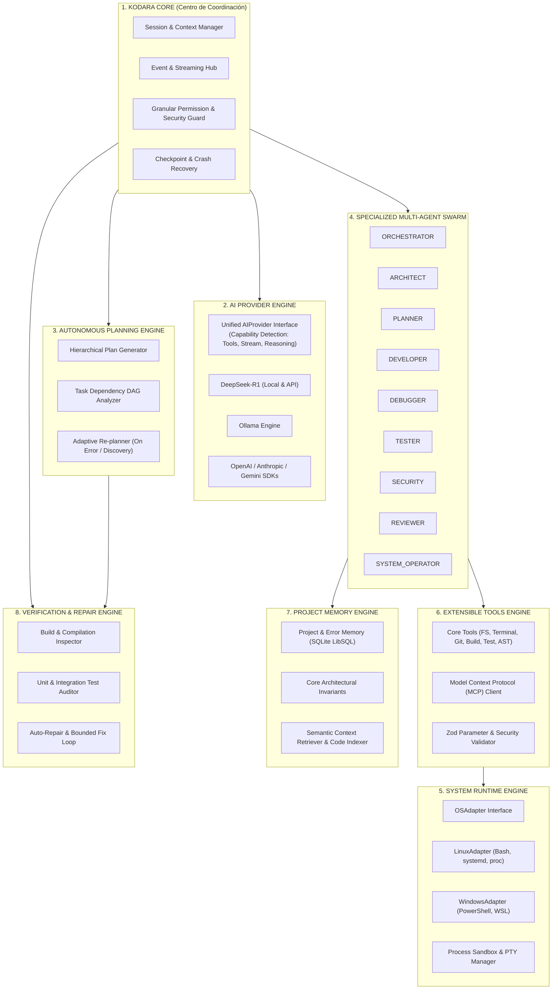

# Plan Maestro de Reestructuración Arquitectónica de Kodara (Restructuring Plan)
**Horizonte de Transformación**: Evolución Incremental a Entorno Autónomo de Desarrollo (Agentic IDE)  
**Principios**: Preservación de activos existentes, Cero código placebo, Modularidad estricta, Multiplataforma (Linux/Windows)

---

## 1. Visión General de la Transformación

El objetivo de esta reestructuración es elevar a Kodara desde un asistente con ejecución de scripts a un **Entorno de Desarrollo Autónomo Multi-Agente** completo. La arquitectura resultante mantendrá plena compatibilidad con las bases de datos y memorias ya existentes (`opencentravity.db`), garantizando una transición fluida sin romper flujos de trabajo anteriores.

---

## 2. Plan de Implementación por Fases (10 Etapas)

```mermaid
flowchart LR
    F1["Fase 1: Auditoría & Docs"] --> F2["Fase 2: Core & Refactorización"]
    F2 --> F3["Fase 3: AI Provider Engine"]
    F3 --> F4["Fase 4: OS Runtime & Tools"]
    F4 --> F5["Fase 5: Planning Engine"]
    F5 --> F6["Fase 6: Multi-Agent Swarm"]
    F6 --> F7["Fase 7: Memoria & Contexto"]
    F7 --> F8["Fase 8: Verificación & Repair"]
    F8 --> F9["Fase 9: UX / UI Rediseño"]
    F9 --> F10["Fase 10: Integración & Optimización"]
```

### FASE 1: Auditoría y Documentación de Arquitectura *(Completada)*
- **Objetivo**: Mapear el 100% del código, documentar deuda técnica, dependencias y riesgos.
- **Entregables**: `docs/PROJECT_AUDIT.md`, `docs/CURRENT_ARCHITECTURE.md`, `docs/TECHNICAL_DEBT.md`, `docs/RESTRUCTURING_PLAN.md`.

### FASE 2: Refactorización del Núcleo y Separación de Responsabilidades
- **Objetivo**: Desacoplar `server.ts` en controladores especializados y crear el módulo `KodaraCore`.
- **Tareas**:
  1. Extraer controladores de dominio: `src/controllers/projects.ts`, `src/controllers/chat.ts`, `src/controllers/plans.ts`, `src/controllers/tools.ts`.
  2. Implementar un bus central de eventos tipado (`CoreEventHub`).
  3. Crear un gestor de sesiones desacoplado del transporte HTTP.
- **Criterio de Aceptación**: Toda la suite existente de 25 pruebas unitarias (`bun test`) aprueba al 100% sin regresiones.

### FASE 3: Implementación del AI Provider Engine
- **Objetivo**: Construir una pasarela de modelos verdaderamente universal que sustituya el `fetch()` directo a Ollama.
- **Tareas**:
  1. Diseñar la interfaz estándar `AIProvider` con detección de capacidades (*tool calling*, streaming, reasoning `<think>`, multimodalidad).
  2. Implementar adaptadores para: `DeepSeekR1Provider` (con soporte para Ollama local y DeepSeek API oficial), `OllamaProvider`, `OpenAICompatibleProvider`, `AnthropicProvider`.
  3. Integrar soporte nativo para bloques de deliberación de DeepSeek-R1, permitiendo al usuario colapsar o inspeccionar el razonamiento profundo.
- **Criterio de Aceptación**: Conmutación transparente de modelos desde la configuración sin tocar código de servidor.

### FASE 4: Sistema de Herramientas y Ejecución Multiplataforma (OSAdapter)
- **Objetivo**: Dotar a Kodara de interacción segura y nativa con Linux y Windows.
- **Tareas**:
  1. Definir la interfaz abstracta `OSAdapter` para ejecución de comandos, procesos, lectura de telemetría y gestión de archivos.
  2. Implementar `LinuxAdapter` (Bash, `/proc`, systemd) y `WindowsAdapter` (PowerShell, WSL).
  3. Reestructurar las herramientas bajo un esquema estándar con validación Zod y permisos granulares.
  4. Implementar cliente MCP oficial para admitir servidores de herramientas externos.
- **Criterio de Aceptación**: Ejecución de herramientas sin bloqueos síncronos en el Event Loop.

### FASE 5: Motor de Planificación Jerárquica Autónoma
- **Objetivo**: Evolucionar `PlanExecutor` y `OrderCompiler` hacia un motor de planificación jerárquica con dependencias (DAG).
- **Tareas**:
  1. Modelo de datos formal de planes: Objetivos, Tareas, Subtareas, Dependencias, Riesgos, Criterios de Aceptación y Archivos Afectados.
  2. Soporte para estados dinámicos: *Pending, Analyzing, Planned, Awaiting Approval, In Progress, Testing, Completed, Failed, Blocked*.
  3. Capacidad de replanificación adaptativa cuando una tarea falla o se descubren dependencias inesperadas.
- **Criterio de Aceptación**: Planes generados automáticamente a partir de requerimientos en lenguaje natural con dependencias verificables.

### FASE 6: Arquitectura Multi-Agente Especializada
- **Objetivo**: Desplegar agentes con identidades, instrucciones, permisos y herramientas específicas.
- **Tareas**:
  1. Definir roles formales: `Orchestrator`, `Architect`, `Planner`, `Developer`, `Debugger`, `Tester`, `Security`, `Reviewer`, `SysOp`.
  2. Implementar comunicación entre agentes con protocolos de paso de mensajes y pizarras compartidas.
  3. Soporte para aislamiento de modificaciones mediante Git Worktrees en tareas concurrentes.
- **Criterio de Aceptación**: Dos o más agentes colaborando en paralelo sobre un mismo proyecto sin conflictos de archivos.

### FASE 7: Memoria Persistente y Gestión Contextual Avanzada
- **Objetivo**: Potenciar la memoria dual de SQLite con indexación semántica y recuperación contextual de precisión.
- **Tareas**:
  1. Segmentar la memoria en: Sesión, Proyecto, Técnica, Decisiones Arquitectónicas y Errores/Soluciones.
  2. Mejorar el indexador de código con soporte AST ligero para recuperar solo firmas y contextos pertinentes.
  3. Implementar compactación automática de contexto para evitar desbordar ventanas de contexto de 32K tokens.
- **Criterio de Aceptación**: Respuestas asistidas por memoria histórica sin introducir todo el repositorio en cada turno.

### FASE 8: Motor de Verificación, Pruebas y Auto-Reparación (Self-Healing)
- **Objetivo**: Erradicar el síndrome de "código generado sin probar".
- **Tareas**:
  1. Pipeline de verificación obligatoria: Sintaxis -> Tipos -> Lint -> Compilación -> Pruebas Unitarias -> Pruebas de Integración -> Auditoría SAST.
  2. Bucle de auto-reparación acotado: ante fallo, análisis de traceback, formulación de hipótesis, edición de archivo y re-ejecución con límite estricto de intentos (máximo 3).
- **Criterio de Aceptación**: Toda tarea autónoma concluye con evidencia tangible de pruebas superadas (exit code = 0).

### FASE 9: Rediseño de la Experiencia de Usuario (Agentic IDE UI)
- **Objetivo**: Convertir `dashboard.html` en un entorno de desarrollo profesional modular.
- **Tareas**:
  1. Paneles dedicados: Panel Principal (Chat & Métricas), Panel de Planificación (DAG & Estados), Explorador de Proyectos con Visor de Diffs, Terminal Web Integrada y Panel de Actividad Multi-Agente.
  2. Trazabilidad completa en tiempo real de cada archivo leído, editado y comando ejecutado.
- **Criterio de Aceptación**: Interfaz fluida, desacoplada y con soporte interactivo para aprobación de planes y diffs.

### FASE 10: Integración Completa, Optimización y Empaquetado
- **Objetivo**: Consolidación final del producto.
- **Tareas**:
  1. Optimización de tiempos de arranque y consumo de memoria.
  2. Creación de instaladores y scripts de despliegue para Linux y Windows.
  3. Documentación completa de usuario y manual de desarrollo de plugins/herramientas.
- **Criterio de Aceptación**: Sistema completo listo para producción y publicado bajo licencia FOSS.
